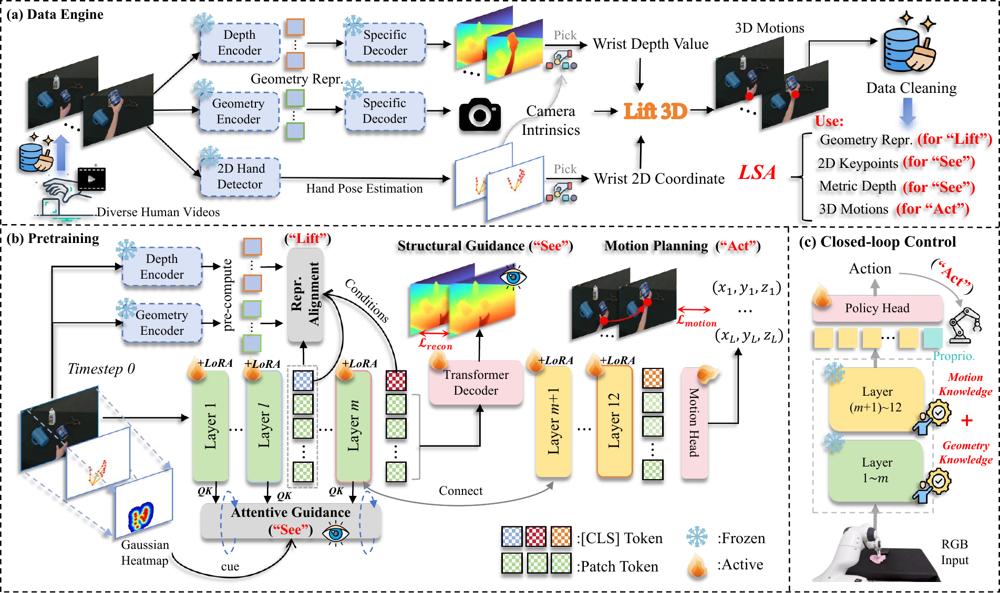

<h1 align="center">Lift, See, Act: Hierarchical Robot Policy Pretraining with 3D Foundation Models</h1>

<p align="center"><strong>NeurIPS 2026</strong></p>

<p align="center">
  <a href="https://scholar.google.com/citations?user=qKxpHGcAAAAJ&hl=zh-CN">Yiyuan Ge</a>,
  Changxing Ding, Ziyu Hao, Zijie Zheng, and Xiangmin Xu
</p>

<p align="center">
  South China University of Technology
</p>

<p align="center">
  <a href="https://yiyuan00.github.io/Lift-See-Act/">Project Page</a>
  &nbsp;&nbsp;
  <a href="https://arxiv.org/pdf/2611.20481">Paper</a>
</p>

<p align="center">
  <a href="assets/f2.pdf">
    
  </a>
</p>

Official implementation of **Lift, See, Act (LSA)**. This repository contains only the code required to extract offline 3D-FM features and reproduce LSA pretraining.

## Installation

```bash
git clone https://github.com/yiyuan00/Lift-See-Act.git
cd Lift-See-Act

conda create -n lsa python=3.10 -y
conda activate lsa
pip install torch==2.3.1 torchvision==0.18.1 --index-url https://download.pytorch.org/whl/cu121
pip install -r requirements.txt

mkdir -p external checkpoints
git clone https://github.com/facebookresearch/vggt.git external/vggt
git -C external/vggt checkout a8f9d63398b438e6bca308c3eeb6b99c67a8328a
pip install -e external/vggt
git clone https://github.com/apple/ml-depth-pro.git external/ml-depth-pro
git -C external/ml-depth-pro checkout 9efe5c1def37a26c5367a71df664b18e1306c708
pip install -e external/ml-depth-pro
```

## Data and Teacher Weights

Download the Depth Pro checkpoint and either let Hugging Face download VGGT automatically or download it manually:

```bash
wget https://ml-site.cdn-apple.com/models/depth-pro/depth_pro.pt \
  -O checkpoints/depth_pro.pt

# Optional: manual VGGT download. Otherwise use --vggt-model facebook/VGGT-1B.
wget https://huggingface.co/facebook/VGGT-1B/resolve/main/model.pt \
  -O checkpoints/vggt_1b.pt
```

Download the prepared DexYCB pretraining data from [ModelScope](https://www.modelscope.cn/datasets/gerryrex/dex_for_pretrain) and extract it into `data/dexycb`:

```bash
pip install modelscope
modelscope download --dataset gerryrex/dex_for_pretrain \
  --local_dir data/dex_for_pretrain
mkdir -p data/dexycb
tar -xf data/dex_for_pretrain/LSA-DexYCB-Pretrain.tar \
  -C data/dexycb
```

The extracted directory has the following structure:

```text
data/dexycb/
├── image/
├── hand_keyPoint/
├── hand_keyPoint2D/
├── dp_image/
└── kpmap/
```

## Offline Feature Extraction

The following command extracts spatially aligned VGGT and Depth Pro features into a resumable memory-mapped cache:

```bash
CUDA_VISIBLE_DEVICES=0,1,2,3 torchrun --standalone --nproc_per_node=4 precompute.py \
  --data-root data/dexycb \
  --cache-root teacher_cache \
  --vggt-model facebook/VGGT-1B \
  --depth-checkpoint checkpoints/depth_pro.pt \
  --batch-size 4
```

If VGGT was downloaded manually, replace `facebook/VGGT-1B` with `checkpoints/vggt_1b.pt`.

## Pretraining

Single GPU (batch size 16):

```bash
CUDA_VISIBLE_DEVICES=0 torchrun --standalone --nproc_per_node=1 train.py \
  --data-root data/dexycb \
  --cache-root teacher_cache \
  --output-root outputs/lsa_single \
  --epochs 50 --warmup-epochs 10 \
  --local-batch-size 16 --global-batch-size 16
```

Four GPUs (batch size 16 per GPU):

```bash
CUDA_VISIBLE_DEVICES=0,1,2,3 torchrun --standalone --nproc_per_node=4 train.py \
  --data-root data/dexycb \
  --cache-root teacher_cache \
  --output-root outputs/lsa_4gpu \
  --epochs 50 --warmup-epochs 10 \
  --local-batch-size 16 --global-batch-size 64
```

Checkpoints and a complete training summary are written to the selected output directory.

## Acknowledgements

This project builds on [VGGT](https://github.com/facebookresearch/vggt), [Depth Pro](https://github.com/apple/ml-depth-pro), and [Hugging Face Transformers](https://github.com/huggingface/transformers).

## Contact

For questions, please contact [1209027338@qq.com](mailto:1209027338@qq.com).

## License

The code in this repository is released under the [Apache License 2.0](LICENSE). Third-party models, datasets, and model weights remain subject to their respective licenses.
